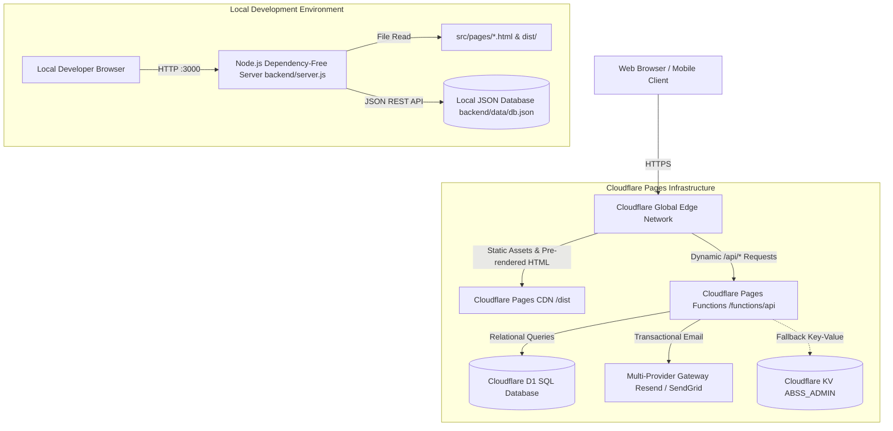
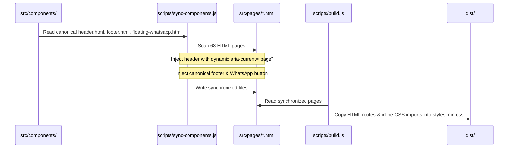
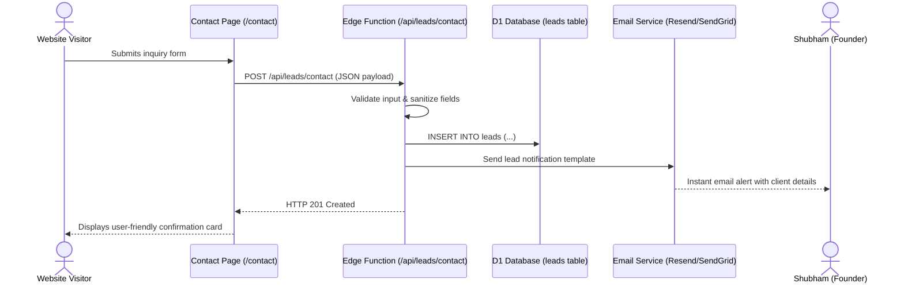
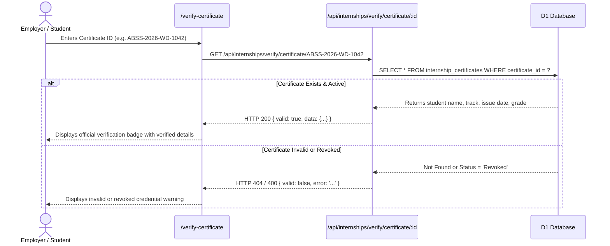
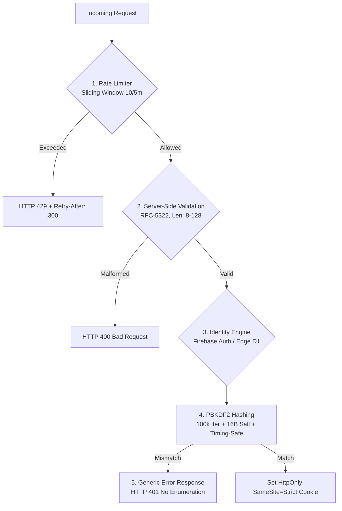

# System Architecture Documentation (ARCHITECTURE.md)
## ABSS Nexus Technologies — Production Platform Architecture

---

## 1. High-Level Architecture Overview

ABSS Nexus Technologies employs a **Dual-Runtime Serverless & Edge Architecture** designed for high availability, zero maintenance overhead, and instantaneous response times.



---

## 2. Dual-Runtime Environment Architecture

### 2.1 Production Edge Runtime (Cloudflare Pages + D1)
- **Host**: Cloudflare Pages with worldwide Anycast edge deployment.
- **Routing**: `_redirects` file governs clean route mapping (e.g., `/services/website-development` -> `/services/website-development.html`).
- **Headers & Security**: `_headers` injects strict security policies, CSP, cache rules, and nosniff directives.
- **API Engine**: Cloudflare Pages Functions (`functions/api/[[path]].js`) executing in the V8 isolate environment at the edge.
- **Primary Persistence**: Cloudflare D1 SQL Database (`ABSS-Website-DB`), a distributed SQLite engine with global read replication.
- **Fallback Persistence**: Cloudflare KV (`ABSS_ADMIN`) for backward compatibility during legacy state synchronization.

### 2.2 Local Development Runtime (Dependency-Free Node.js)
- **Server**: `backend/server.js` running on standard Node.js without third-party npm runtime dependencies (pure native `http`, `fs`, `path`, `crypto`).
- **Port**: Default `3000` (configurable via `PORT` environment variable).
- **Persistence**: File-based transactional JSON database located at `backend/data/db.json`.
- **API Compatibility**: Implements identical REST endpoints as production Cloudflare Pages Functions, ensuring seamless parity during development.

---

## 3. Directory Layout & Layer Responsibilities

```text
/Users/shubhamkumar/New-ABSS-Deploy/
├── src/                               # Canonical Source of Truth
│   ├── components/                   # Canonical HTML components (header, footer, WhatsApp)
│   ├── pages/                        # Public HTML pages (Home, About, Services, Contact, etc.)
│   ├── admin/                        # Admin management console templates
│   ├── styles/                       # CSS architecture, components, and design system
│   │   └── components/               # Modular CSS bundles (header, hero, footer, etc.)
│   ├── scripts/                      # Client-side JavaScript controllers and utilities
│   │   ├── components/               # Scroll-reveal, hero-parallax, footer logic
│   │   └── config/                   # Central contact and environment configuration
│   └── services/                     # Frontend API services (admin-api.js, etc.)
├── functions/                        # Cloudflare Pages Functions (Production Edge API)
│   ├── api/[[path]].js               # Unified REST gateway router
│   └── _lib/                         # Edge libraries (d1-storage.js, email-service.js)
├── migrations/                       # Cloudflare D1 SQL schema migrations (0001 to 0005)
├── backend/                          # Local Node.js development server
│   ├── server.js                     # Native HTTP server & mock edge API
│   └── data/db.json                  # Local JSON database file
├── public/                           # Static assets, logos, mockups, documents, seals
│   └── assets/images/                # Web-optimized imagery and device frames
├── dist/                             # Compiled production build directory
├── scripts/                          # Build, sync, and automation tooling
│   ├── sync-components.js            # Single-source component injector
│   ├── build.js                      # Compilation, @import inlining, minification
│   ├── check-css-braces.js           # Syntax and bracket balance auditor
│   └── validate.sh                   # Comprehensive 16-point test runner
└── tests/                            # Automated verification test suites
```

---

## 4. Component Synchronization Engine

To guarantee 100% UI consistency across all 68+ routes without template engine overhead:



---

## 5. Database Schema & Data Models (Cloudflare D1)

Cloudflare D1 uses SQL migrations located in `/migrations/`:

### 5.1 Core Business Tables (`0001` - `0003`)
- `leads`: Inbound inquiries (name, email, phone, service, budget, timeline, message, status, notes).
- `projects`: Client deliveries (title, category, client_name, completion_date, metrics, url).
- `clients`: Customer registry (company, contact_person, email, phone, status, contract_value).
- `support_tickets`: Client issues (ticket_id, client_id, subject, priority, status).
- `pricing_packages`: Tiered pricing catalog (name, category, price, features, is_featured).
- `admin_users`: Credentials and roles for administrative access.
- `audit_logs`: Timestamped administrative actions and modifications.

### 5.2 Internship Academy & Verification Tables (`0004` - `0005`)
- `internship_programs`: 5 official tracks (Web, Software, UI/UX, AI/ML, Cloud/DevOps).
- `internship_applications`: Applicant submissions (application_id, program_id, status, duration).
- `internship_students`: Verified active students (student_id, email, password_hash, is_verified).
- `internship_tasks`: Curriculum milestones and engineering briefs.
- `internship_submissions`: Student work uploads (repo_url, live_demo_url, status).
- `internship_certificates`: Tamper-proof credentials (certificate_id, student_name, track, issue_date, grade, status).

---

## 6. End-to-End Data Flows

### 6.1 Public Client Inquiry Flow


### 6.2 Certificate Verification Flow


---

## 7. Performance & Optimization Architecture
1. **Zero Network Waterfalls**: Inlined `@import` statements ensure the browser downloads a single consolidated `styles.min.css`.
2. **IntersectionObserver Scroll Reveal**: Minimal CPU cycles, observes offscreen cards, and unobserves upon entry.
3. **Hardware-Accelerated Compositing**: Animations strictly use `transform` (`translateY`) and `opacity` to avoid layout reflows.
4. **Edge Caching**: Static assets served with `Cache-Control: public, max-age=31536000, immutable` headers.

---

## 8. Authentication & Security Architecture

### 8.1 Core Security Mandates
The platform enforces 5 strict security principles across both Edge functions (`functions/api/[[path]].js`) and local server (`backend/server.js`):



1. **Server-Side Validation**:
   - RFC 5322 email validation (`EMAIL_REGEX`).
   - Passwords strictly bounded between 8 and 128 characters to protect against ReDoS / CPU exhaustion.
   - String inputs bounded to protect database integrity.
2. **Rate Limiting**:
   - Sliding-window in-memory rate limiting keyed by client IP (`cf-connecting-ip`, `x-forwarded-for`).
   - Authentication routes capped at 10 requests per 5-minute window; returns HTTP 429 with `Retry-After: 300`.
3. **Cryptographic Password Encryption**:
   - Passwords hashed using PBKDF2 with 100,000 iterations and 16-byte cryptographically secure random salt.
   - Verified using constant-time comparison (`crypto.timingSafeEqual` in Node.js, `constantTimeEqual` in Edge Functions).
4. **Generic Error Responses (Zero Enumeration)**:
   - Identical error message (`"Invalid email or password."`) regardless of whether an account exists or the password is bad.
   - Password reset always yields identical HTTP 200 response (`"If an account with that email exists, password reset instructions have been generated."`).
5. **Firebase Authentication Architecture**:
   - Client-side modular wrapper in `src/scripts/firebase-auth.js` and `src/services/firebase-config.js`.
   - Supports Google Sign-In and standard Email/Password authentication.
   - Graceful fallback to Cloudflare D1 edge database if Firebase credentials are omitted or during edge offline mode.

