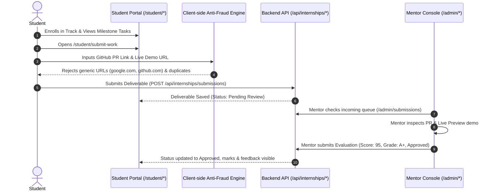

# Project Context Documentation (CONTEXT.md)
## ABSS Nexus Technologies — Full Stack Platform Context & Architecture

---

## 1. Executive Summary & Project Purpose

**ABSS Nexus Technologies** is an enterprise technology solutions and education delivery platform consisting of:
1. **Corporate Client Portal**: Enterprise IT consulting, custom software development, cloud infrastructure, AI integrations, case studies, and client lead management.
2. **Technical Internship Academy (16 Tracks)**: Comprehensive industry internship programs with interactive syllabi, 5 hands-on milestones per domain, student workspace, anti-fraud submission verification, and cryptographically verifiable ISO certificates.
3. **Student Learning Portal**: Interactive portal featuring domain track switchers, milestone roadmap boards, deliverable submission forms, AI career mentor chat, resume builder, and interview simulator.
4. **Operations & Mentor Admin Console**: Dual-view management system (Company Admin & Internship Admin) with live submission queues, code inspection tooling, rubric-based grading, certificate minting, and audit logging.

---

## 2. Technology Stack & Dual-Runtime Architecture

ABSS Nexus operates on a **Dual-Runtime Serverless & Edge Architecture** with zero runtime drift between local development and edge production.

```mermaid
graph TD
    Client[Web Browser / Mobile Client] --> EdgeRouter[Edge Router / Local Proxy]
    
    subgraph Production Runtime (Cloudflare Pages)
        EdgeRouter --> StaticCDN[Cloudflare Global CDN /dist]
        EdgeRouter --> WorkerFunctions[Cloudflare Pages Functions /functions/api]
        WorkerFunctions --> D1[(Cloudflare D1 SQLite Database)]
        WorkerFunctions --> EmailGateway[Resend / SendGrid API]
    end

    subgraph Local Development Runtime (Node.js)
        EdgeRouter --> LocalServer[backend/server.js :3000]
        LocalServer --> LocalPages[src/pages/*.html]
        LocalServer --> LocalDB[(backend/data/db.json)]
    end
```

### 2.1 Core Technologies
- **Frontend Structure**: Semantic HTML5 with strict a11y accessibility standards.
- **Styling**: Vanilla CSS with modern custom properties (CSS variables), CSS Grid, and Flexbox (`src/styles/styles.css`).
- **Client Logic**: Vanilla JavaScript ES6+ (no heavy frontend framework dependencies for maximum performance and sub-second Largest Contentful Paint).
- **Backend Server (Local)**: Dependency-free Node.js (`backend/server.js`) using native `http`, `fs`, `path`, and `crypto`.
- **Backend Edge (Production)**: Cloudflare Pages Functions (`functions/api/[[path]].js`) executing in V8 isolates.
- **Database Persistence**: Cloudflare D1 SQL (`d1-storage.js`) in production, file-backed atomic JSON database (`backend/data/db.json`) locally.

---

## 3. The 16 Industry Internship Domains

All 16 domains feature dedicated curriculum landing pages (`/internships/programs/<slug>`), detailed task breakdowns, and 5 sequential milestone deliverables configured in `src/scripts/domain-tasks-data.json`:

| # | Domain Track | Category | Milestones & Deliverables | Syllabus Route |
|---|---|---|---|---|
| 1 | **Web Development** | Engineering | Semantic HTML5, REST API Integration, Auth & DB, Full-Stack SaaS, Production Deployment | `/internships/programs/web-development` |
| 2 | **Data Science** | AI & Data | Exploratory Data Analysis, Feature Engineering, Supervised Learning, Model Deployment, Capstone | `/internships/programs/data-science` |
| 3 | **Machine Learning** | AI & Data | Vector Math & Algorithms, PyTorch Deep Learning, CNNs & Vision, NLP Transformers, MLOps | `/internships/programs/machine-learning` |
| 4 | **Data Analyst** | AI & Data | Advanced SQL (CTEs, Windowing), Power BI Modeling, Cohort Retention, Financial Dashboards, Executive Briefing | `/internships/programs/data-analyst` |
| 5 | **Cyber Security** | Engineering | Network Wireshark Traffic, OWASP Top 10 Auditing, Linux Hardening, Cryptographic Signatures, SOC Incident Response | `/internships/programs/cyber-security` |
| 6 | **Software Development** | Engineering | OOP Architecture, Relational Schema & ORM, Async Microservices, CI/CD Actions, Distributed Systems | `/internships/programs/software-development` |
| 7 | **Prompt Engineering** | AI & GenAI | Advanced Few-Shot Prompting, Structured JSON Extraction, Multi-Turn System Prompts, Safety & Guardrails, Evaluation Suite | `/internships/programs/prompt-engineering` |
| 8 | **Agent Engineering** | AI & GenAI | ReAct Autonomous Loops, Multi-Tool Agent Orchestration, Short/Long-Term Memory, Multi-Agent Swarms, Enterprise Ops | `/internships/programs/agent-engineering` |
| 9 | **AI Engineering** | AI & GenAI | LLM RAG Vector Search, Embedding Pipeline Tuning, Fine-Tuning LoRA Adapters, Semantic Caching, Production LLM Gateway | `/internships/programs/ai-engineering` |
| 10 | **Android Development** | Engineering | Kotlin Fundamentals, Jetpack Compose UI, MVVM Architecture & Room DB, Retrofit REST APIs, Google Play Release Bundle | `/internships/programs/android-development` |
| 11 | **Product Management** | Business & Ops | PRD Formulation, User Journey & Wireframes, Metrics & A/B Testing, Feature Prioritization (RICE), Go-To-Market Pitch | `/internships/programs/product-management` |
| 12 | **UI/UX Design** | Design & Media | User Persona & Heuristic Audit, Figma Wireframes & Systems, Responsive High-Fidelity UI, Micro-Interactions, Usability Testing | `/internships/programs/ui-ux-design` |
| 13 | **Graphics Design** | Design & Media | Brand Identity Guidelines, Typography & Color Systems, Vector Marketing Assets, Packaging & Print, Multi-Channel Campaign Kit | `/internships/programs/graphics-design` |
| 14 | **Human Resources** | Business & Ops | Talent Acquisition Strategy, Candidate Screening Rubric, Onboarding & 30-60-90 SOP, OKR Performance Matrix, HR Metrics Dashboard | `/internships/programs/human-resources` |
| 15 | **Digital Marketing** | Marketing | Technical SEO Audit, Content Marketing Calendar, Google & Meta Ads Campaigns, Email Automation Funnel, Conversion Optimization | `/internships/programs/digital-marketing` |
| 16 | **Content Writing** | Marketing | 1,500+ Word SEO Longform Article, High-Converting Landing Page Copy, Technical Case Study, Whitepaper Brief, Thought Leadership | `/internships/programs/content-writing` |
| 17 | **Cloud & DevOps** *(Legacy)* | Engineering | Cloudflare Edge Architecture, Containerization, Serverless Routing, Monitoring, SSL Hardening | `/internships/programs/cloud-devops` |

---

## 4. Student Workflow & Submission Pipeline



### 4.1 Anti-Fraud & Quality Gates
1. **Generic Root URL Rejection**: Submissions with base domains (`github.com`, `google.com`, `figma.com`, `youtube.com`) without a specific repository or project path are rejected with instant user guidance.
2. **Cross-Milestone Duplicate Detection**: Prevents interns from reusing the exact same pull request or project URL across multiple milestones in the same track.
3. **Dual State Persistence**: Submissions immediately sync to both browser local storage (`abss_tasks_<slug>`, `abss_subs_<slug>`) and server database (`db.internshipSubmissions`).

---

## 5. Operations Console & Mentor Grading Studio

The admin portal provides two modular management experiences:
1. **Company Administration (`/admin/company/`)**:
   - Manage website inquiries/leads, services, client projects, careers, candidates, and CMS content.
2. **Internship Administration (`/admin/internships/`)**:
   - **Work Submissions Queue (`/admin/submissions` & `/admin/internships/submissions`)**: Real-time queue showing intern name, email, track domain, milestone ID, direct links to code and live demo preview, submission date, and current review status.
   - **Evaluations & Reviews Studio (`/admin/reviews` & `/admin/internships/reviews`)**: Interactive evaluation modal allowing mentors to:
     - Open and inspect the repository code and live preview in a new tab.
     - Review student implementation summary notes.
     - Assign milestone status: **🟢 Approve (Pass Milestone)** or **🔴 Request Revisions (Needs Changes)**.
     - Input score (0 to 100) and select grade tier (`Grade A+ Distinction`, `Grade A Excellent`, `Grade B Good`, `Needs Revision`).
     - Write constructive technical feedback notes.
   - **Certificates Registry (`/admin/certificates`)**: Issue and revoke cryptographically verifiable student certificates (`ABSS-CERT-2026-XXXX`).

---

## 6. Directory Map & File Architecture

```text
/Users/shubhamkumar/New-ABSS-Deploy/
├── backend/
│   ├── server.js                      # Dependency-free Node.js local dev server & REST API
│   └── data/db.json                   # Local transactional database (leads, students, submissions, reviews)
├── functions/
│   └── api/[[path]].js                # Cloudflare Pages Functions edge API handler
├── src/
│   ├── admin/                         # Admin templates (submissions, reviews, students, certificates)
│   ├── components/                    # Canonical component source of truth (header, footer, nav)
│   ├── config/                        # Admin configuration and storage keys
│   ├── pages/                         # Public and Student portal pages (68 canonical routes)
│   ├── scripts/
│   │   ├── admin-app.js               # Admin console engine, real-time metrics, review modals
│   │   ├── domain-tasks-data.json     # Single source of truth for 16 tracks and all milestone tasks
│   │   └── student-dashboard.js       # Student portal state controller, track switcher, chat
│   └── styles/                        # Modular CSS system
├── scripts/
│   ├── build.js                       # Production asset compilation and dist packaging
│   ├── sync-components.js             # Propagates header/footer components across all pages
│   └── generate-domain-programs.js    # Programmatic generator for syllabus pages
└── tests/
    └── test-all-68-pages.js           # Comprehensive HTTP route verification suite (131 routes)
```

---

## 7. Build, Validation & Deployment Commands

```bash
# 1. Start local development server (Port 3000)
npm start

# 2. Synchronize canonical components and compile production bundle
npm run build

# 3. Execute complete route and API validation suite (131 Routes)
node tests/test-all-68-pages.js

# 4. Deploy to Cloudflare Pages (Production)
npx wrangler pages deploy dist --project-name=abss-nexus-technologies
```

---

## 8. Verified Health & Route Status

As of October 2026:
- **Total Validated Routes**: **131 Routes (0 Failures)**
- **Build Status**: **Clean 0 Errors**
- **Canonical Git Branch**: `main` on `Shubham-ABSS-Nexus-Technologies/New-ABSS`
